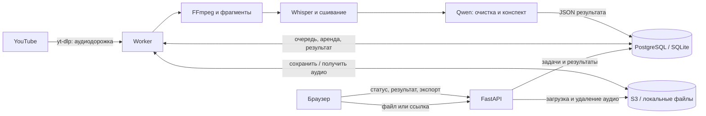

# Архитектура Лекториума

Лекториум превращает аудиозапись лекции или публичное видео YouTube в расшифровку и русский конспект. API принимает источник и создаёт задачу; отдельный worker выполняет скачивание и обработку. Закрытие страницы не прерывает работу. Инструкции запуска находятся в [README](../README.md).

## Компоненты

- **API** проверяет входные данные, ограничивает размер запросов, сохраняет загруженные файлы, выдаёт состояние и результаты, обслуживает интерфейс. Модели в HTTP-процессе не загружаются.
- **Worker** последовательно обрабатывает задачи, продлевает аренду, скачивает YouTube-аудио и запускает ML-пайплайн. Для одного GPU предполагается один worker.
- **БД** хранит очередь, состояние, исходное название, ссылку YouTube, ключ аудио, длительность и JSON результата. Отдельный брокер очереди не требуется.
- **Хранилище** содержит оригинальные аудиофайлы. В режиме `local` это `DATA_DIR/uploads`, в режиме `s3` - S3-совместимый бакет, в Compose используется RustFS. Временные файлы обработки удаляются после задачи.
- **Интерфейс** написан на HTML/CSS/JavaScript, опрашивает API и отображает текст без исполнения модельного HTML. В `localStorage` хранится идентификатор выбранной лекции.

## Обработка записи

1. API принимает multipart-файл, проверяет расширение и сигнатуру, сохраняет аудио и создаёт задачу `queued`. Для YouTube создаётся задача с канонической ссылкой и ключом `pending`; скачивание начинается в worker.
2. Worker получает источник из хранилища. Для нового YouTube-источника скачивает только аудиодорожку, проверяет ограничения и сохраняет её в хранилище перед распознаванием.
3. FFmpeg декодирует запись в mono WAV 16 кГц. Запись читается фрагментами; по умолчанию это 30 секунд с перекрытием 4 секунды. Цифровая тишина пропускается по уровню сигнала, без полноценной VAD-модели.
4. `openai/whisper-large-v3-turbo` распознаёт каждый фрагмент. При пересечении соседних фрагментов эвристика сопоставляет конец предыдущего текста с началом нового и удаляет совпавшее перекрытие.
5. Whisper выгружается, затем загружается `Qwen/Qwen3.5-4B`. Текст делится по бюджету токенов: Qwen редактирует расшифровку и независимо составляет конспекты из исходных сшитых фрагментов.
6. Для длинной лекции частичные конспекты сводятся в обзор; итог сохраняет обзор и конспекты отдельных частей. Результат записывается в БД, задача становится `completed`.

Различия текстов в JSON результата:

| Поле | Содержание |
|---|---|
| `raw_transcript` | Исходные ответы Whisper по фрагментам, до сшивания; повторы от перекрытия сохранены |
| `metadata.merged_asr_text` | Ответы Whisper после удаления перекрытий; источник для очистки и конспекта |
| `transcript` | Отредактированная Qwen расшифровка с абзацами на языке источника; отдельные части могут сохраниться без модельной редактуры |
| `summary` | Русский конспект в Markdown; это сокращение материала, а не полная расшифровка |
| `segments` | Сшитые ASR-фрагменты `{start, end, text}`; время в секундах, границы приблизительные |
| `duration_seconds`, `metadata` | Длительность, модели, параметры результата, предупреждения и сведения об обработке |

Если очистка потеряла числовые литералы, заметно сократила текст или обнаружена смена языка EN/RU, сохраняется исходный сшитый фрагмент. При необходимости абзацы добавляются без переписывания текста. Причины отражаются в `cleanup_warnings`. Проверки эвристические и не гарантируют сохранения всех смыслов.

Объём конспекта задаётся как цель. После одной попытки дополнительного сжатия слишком длинный ответ сохраняется с `summary_length_warnings`, без механического обрезания. Оборванная генерация из-за лимита токенов считается ошибкой.

## Очередь и восстановление

Состояния задачи: `queued` → `processing` → `completed` или `failed`. `stage` описывает текущий этап, `progress` находится в диапазоне 0-1. Возможные этапы включают `preparing`, `downloading`, `normalizing`, `transcribing`, `loading_summarizer`, `cleaning`, `summarizing`, `saving`.

Worker выбирает самую раннюю задачу и захватывает её условным обновлением статуса. Вместе с задачей получает уникальный `worker_token` и аренду: по умолчанию 180 секунд, heartbeat каждые 15 секунд. Обновлять состояние и результат может только текущий владелец.

После истечения аренды прерванная задача возвращается в очередь, а после исчерпания `MAX_JOB_ATTEMPTS` становится `failed`. По умолчанию допускаются три захвата задачи. Обычная ошибка скачивания или inference сразу завершает задачу ошибкой; автоматический повтор предусмотрен для восстановления прерванной обработки.

При повторной обработке ASR и конспект вычисляются заново. YouTube-аудио используется повторно, если ключ сохранённого объекта уже записан в БД. Сбой до фиксации ключа может потребовать нового скачивания.

При SIGINT/SIGTERM worker завершает работу на ближайшей границе этапа или callback и возвращает задачу в очередь без расхода попытки восстановления. Принудительное завершение восстанавливается через истечение аренды. При недоступности БД возможны повторные вычисления; токен защищает запись результата от устаревшего владельца.

## HTTP API

`JobResponse` содержит `id`, `filename`, `language`, `source_url`, `status`, `stage`, `progress`, `error`, `created_at`, `updated_at`, `duration_seconds`. Времена выдаются в UTC. Полный JSON результата запрашивается отдельно.

| Метод и путь | Вход | Успешный ответ | Основные ошибки |
|---|---|---|---|
| `POST /api/lectures` | multipart: `file`, необязательный `language` | `202`, `JobResponse` | `400` пустой файл; `413` размер; `415` формат; `422` язык; `503` сохранение |
| `POST /api/lectures/youtube` | JSON: `url`, необязательный `language` | `202`, `JobResponse` | `413` размер JSON; `422` ссылка или язык |
| `GET /api/lectures` | `limit` 1-100, по умолчанию 30; `offset` от 0 | `200`, `{items: [JobResponse], total}`; новые первыми | `422` параметры |
| `GET /api/lectures/{id}` | Идентификатор задачи | `200`, `JobResponse` | `404` |
| `PATCH /api/lectures/{id}` | JSON: `{"filename":"Новое название"}` | `200`, обновлённый `JobResponse` | `404`, `409` активная задача, `413`, `422`, `503` |
| `DELETE /api/lectures/{id}` | Идентификатор задачи | `204`, без тела | `404`, `409` активная задача, `503` удаление |
| `GET /api/lectures/{id}/result` | Идентификатор задачи | `200`, JSON результата | `404`, `409` результат недоступен |
| `GET /api/lectures/{id}/download` | `format=md\|txt\|json`, по умолчанию `md` | `200`, файл результата | `404`, `409`, `422` формат |
| `GET /health` | - | `200`, `status`, `storage_backend`, `database_backend` | `503` БД недоступна |
| `GET /` и `GET /static/...` | - | Интерфейс и его ресурсы | `404` отсутствующий ресурс |
| `GET /docs`, `GET /redoc`, `GET /openapi.json` | - | Интерактивная документация и схема | - |

`language` принимает `ru`, `en` и другие буквенные коды из 2-3 символов; `auto`, пустое значение или отсутствие включают определение Whisper. Этот параметр не меняет целевой русский язык конспекта.

Переименование и удаление разрешены только для `completed` и `failed`. Пробелы по краям названия удаляются; оно должно содержать 1-255 символов без путей и управляющих символов. Дополнительные поля JSON запрещены. Переименование меняет отображаемое `filename` и заголовок Markdown-экспорта, сохраняя текст результата и ключ аудио.

Удаление сначала удаляет аудио, затем строку БД вместе с результатом; для ключа `pending` обращение к хранилищу пропускается. При ошибке хранилища запись сохраняется для повторной попытки. Операции сериализуются блокировкой строки PostgreSQL или транзакцией записи SQLite.

## Настройки и хранение

Настройки читаются из окружения и `.env` через `Settings`. API и worker должны использовать одну БД и одно хранилище; для `local` нужен общий каталог загрузок.

| Группа | Основные параметры |
|---|---|
| БД и данные | `DATABASE_URL` (по умолчанию SQLite `data/lectures.db`), `DATA_DIR`, `STORAGE_BACKEND=local\|s3` |
| S3 | `S3_ENDPOINT_URL`, `S3_BUCKET`, `S3_ACCESS_KEY_ID`, `S3_SECRET_ACCESS_KEY`, `S3_REGION` |
| Ограничения | `MAX_UPLOAD_MB=500` (МиБ), `MAX_AUDIO_SECONDS=14400` (4 часа); JSON YouTube и переименования ограничен 16 КиБ |
| Модели | `HF_HOME=models`, `MODEL_DEVICE=auto\|cpu\|cuda`, `WHISPER_MODEL`, `QWEN_MODEL`, `MODEL_LOCAL_FILES_ONLY=true` |
| Пайплайн | `FFMPEG_PATH`, `CHUNK_SECONDS=30`, `CHUNK_OVERLAP_SECONDS=4`, `SUMMARY_CHUNK_TOKENS=1800`, `SUMMARY_MAX_NEW_TOKENS=900`, `QWEN_LOAD_IN_4BIT=true` |
| Очередь | `POLL_INTERVAL_SECONDS=1`, `LEASE_SECONDS=180`, `HEARTBEAT_SECONDS=15`, `MAX_JOB_ATTEMPTS=3` |

Значения в таблице - программные значения по умолчанию; профили запуска могут их переопределять. Модели скачиваются заранее в кэш `HF_HOME/hub`; Whisper и Qwen не находятся в памяти одновременно. Qwen использует 4-битную загрузку при включённом параметре на CUDA, на CPU - обычные веса.

Compose использует PostgreSQL и RustFS, отдельные каталоги данных API/worker и общий кэш моделей только для чтения. Схема БД создаётся при запуске; предусмотрено добавление колонки `source_url` для старой схемы, общей системы миграций нет.

## Структура проекта

| Файлы | Ответственность |
|---|---|
| `lecture_service/main.py`, `schemas.py` | Маршруты, ограничения HTTP, контракты запросов и ответов |
| `lecture_service/config.py`, `db.py`, `storage.py` | Настройки, модель задачи, доступ к БД и аудио |
| `lecture_service/worker.py`, `youtube.py` | Очередь, восстановление, скачивание YouTube |
| `lecture_service/pipeline.py`, `audio.py`, `asr.py`, `summarizer.py` | Оркестрация, FFmpeg, Whisper, сшивание, Qwen |
| `lecture_service/static/` | Интерфейс «История», результаты и экспорт |
| `scripts/` | Подготовка окружения, скачивание моделей, запуск и диагностика |
| `tests/` | Автотесты API, очереди, хранилища и обработки аудио и текста |
| `Dockerfile`, `compose.yaml`, `.env.example` | Контейнерный запуск и пример настроек |

## Ограничения

Сервис рассчитан на лекционную речь. Сшивание перекрытий эвристическое: оно может удалить осмысленные повторы, особенно в песнях; специального режима для песен нет. Для проверки доступны исходные ответы Whisper. Метки времени приблизительные, диаризации и выравнивания по словам нет. Конспект может ошибаться и требует сверки с источником.

YouTube поддерживает общедоступное одиночное видео по HTTPS; плейлисты, текущие трансляции и доступ через аккаунт не поддерживаются. Доступность скачивания зависит от провайдера. `/health` проверяет БД, но не worker, S3 и возможность inference.

Авторизации, ручной отмены активной задачи и автоматической политики хранения нет. S3 и БД не образуют общую транзакцию: аварийный сбой может оставить объект без задачи либо запись без аудио. Для внешнего размещения нужны контроль доступа, TLS, резервное копирование и уборка осиротевших объектов.
